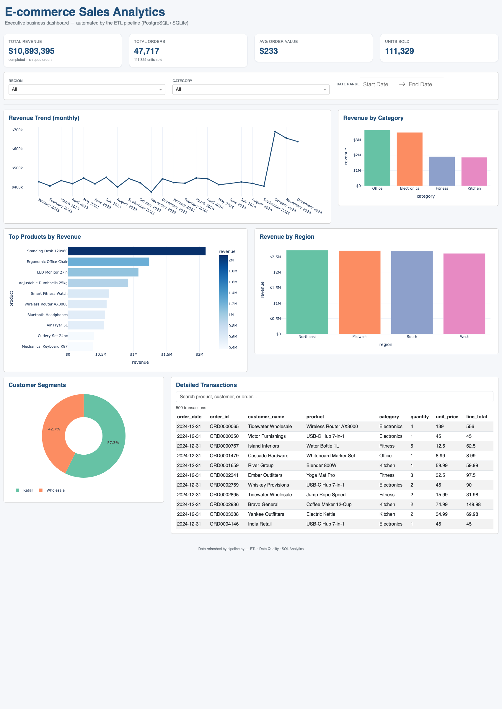

# E-commerce Sales Analytics — Automated Data Pipeline

**An end-to-end ETL pipeline that turns messy raw e-commerce transaction data into a clean database, SQL analytics and an interactive executive dashboard — fully automated, with strict data-quality handling.**

<p align="center">
  
</p>

<div align="center">


</div>

---

## Business Problem (for non-technical readers)

A store sells products across multiple categories and records every order. Sales
data comes out of the store system in a **raw, messy form** — prices written as
"$24.99", dates in different formats, blank fields, duplicate lines, occasional
typos, and some rows that are simply broken.

Each week somebody has to manually clean all of that in a spreadsheet, plug it
into reports, and re-check it by hand. It is slow, error-prone, and nobody really
trusts the numbers.

**The problem this system solves:** it takes that messy raw data and
automatically turns it into clean, trustworthy numbers an executive can act on —
total revenue, which products sell, which categories grow, how the regions
compare — all refreshed with one command, no manual spreadsheet work.

## Solution

This repository implements a complete, production-style **data pipeline**:

1. **Extracts** raw transaction data.
2. **Validates** it against defined data-quality rules.
3. **Transforms** it into a clean **star schema** (fact + dimension tables).
4. **Loads** it into a SQL database (SQLite for the demo, PostgreSQL in Docker).
5. **Runs SQL analytics** to answer real business questions.
6. **Visualizes** the results in an interactive dashboard.

Every step is logged, handles errors and bad data explicitly, and produces a
data-quality report so you can see exactly what was accepted, what was rejected,
and why.

## Architecture

```
 RAW DATA              EXTRACT              VALIDATE              TRANSFORM
 (messy CSV)    ->     read + log     ->    quality rules  ->     clean, standardise,
                                            reject junk          de-duplicate, derive
                                                                  ---------------------------------
 LOAD                 ANALYZE              VISUALIZE                          |
 (Postgres/SQLite) -> SQL queries    ->    Dash dashboard                      |
 star schema          business KPIs        for executives                      |
                                    ^                                            |
                                    |                  Quality report + rejected |
                                    +-------------------- rows for inspection    |
```


## Technologies

| Technology | Why it is used |
|---|---|
| **Python 3** | Core data-engineering language — the entire pipeline. |
| **pandas / numpy** | Cleaning, transforming and normalising the data. |
| **SQLAlchemy** | Database-agnostic access (same code runs on SQLite and PostgreSQL). |
| **SQLite** | Zero-install local demo so you can run everything immediately. |
| **PostgreSQL** | Production database used by the Docker deployment. |
| **Dash / Plotly** | Interactive executive dashboard (pure Python). |
| **Docker / Compose** | Reproducible deployment (database + ETL + dashboard). |
| **GitHub Actions** | CI: tests + full pipeline run on every push. |
| **pytest** | Unit tests for the validation / transformation / load logic. |

## The Data Pipeline

`Extract → Validate → Transform → Load → Analyse → Visualize`

- **Extract** — reads the raw file; logs source, row count, timestamp. If the
  source is missing, a reproducible synthetic dataset is generated (with the
  same kind of messiness a real store export has).
- **Validate** — applies per-field rules (dates, prices, quantities, required
  fields). Invalid rows are rejected with a recorded reason.
- **Transform** — normalises types and dates, parses `$1,299.00` style prices,
  standardises categories/statuses, fills missing values with documented
  fallbacks, removes duplicates, computes `line_total` and a `revenue_flag`.
- **Load** — creates the schema and loads dimensions then facts idempotently.
- **Analyse** — `sql/analytics.sql` answers the business questions.
- **Visualize** — the dashboard surfaces the same metrics to the user.

The dashboard is **interactive**: the Region / Category / Date-range filters
adjust every chart **and** the KPI cards, all scoped at the SQL level.

## Data Quality

The synthetic source is deliberately **not perfect** — it mimics a real store
export. It contains, among other things: missing prices/customers/categories,
currency-string prices, malformed prices (`"abc"`, `"0.05.5"`), invalid/future
dates, out-of-range quantities, duplicate lines, and messy categorical labels.

The pipeline handles all of it explicitly:

- **Rejected rows** → written to `data/quality/rejected_records.csv` with a
  reason, and counted in the quality report.
- **Duplicates** → detected, counted, removed.
- **Missing values** → rejected where required, otherwise filled with a
  documented fallback.
- **Quality report** → `data/quality/quality_report.md` (JSON too) shows totals,
  valid/rejected/duplicate counts and per-rule and per-column breakdowns.

Example from a run on 50,750 raw rows:

| Metric | Value |
|---|---|
| Valid rows loaded | 48,473 |
| Rejected rows | 2,277 |
| Duplicates removed | 467 |

## Database

A **star schema** optimised for fast analytics:

```
 dim_product  ─┐
 dim_customer ─┼──>  fact_sales  ──>  dim_date
```

- `fact_sales` — one row per order line item (order, date, customer, product,
  quantity, unit price, line total, status).
- `dim_product` — products and categories.
- `dim_customer` — customers, segment, city, region.
- `dim_date` — calendar attributes (year, month, quarter, seasonality) for
  time-series analysis.

Primary and foreign keys, plus indexes on the fact table, make the analytics
queries fast. The schema DDL lives in `sql/schema.sql`; the analytics queries in
`sql/analytics.sql`.

## Business Insights

The following insights are generated **directly from the data** produced by the
pipeline (a ~50k-row run):

- **Total revenue ≈ $10.9M** across ~47.7k orders, with an **average order value
  ≈ $233** and **111k+ units sold**.
- **Year-over-year revenue grew ~14%** (2024 vs 2023), with a clear **Q4 seasonal
  bump** — October revenue jumped ~70% month-over-month, so stock purchasing and
  staffing can be planned around Q4 demand.
- **Office is the top category** (33% of revenue), led by *Standing Desk 120x60*;
  **Electronics** is close behind (32%), led by *LED Monitor 27in*.
- **Revenue is evenly spread** across the four regions (Northeast, South,
  Midwest, West), so no single region dominates — a healthy, diversified base.
- **Retail contributes ~52% of revenue**; Wholesale ~48% — useful for focused
  marketing and pricing strategies.

These are real numbers from the pipeline output, not placeholders.

## Result / Business Value

- **Saves hours of weekly manual spreadsheet work** — one command refreshes everything.
- **Trustworthy, consistent numbers** — data-quality checks catch bad rows instead
  of letting them silently corrupt reports.
- **Actionable decisions** — executives can see revenue trends, top products,
  category and regional performance, and drill into live transactions.
- **Automation + auditability** — every run is logged and every pipeline run is
  recorded with a timestamp.

## How to Run

### Option A — Run locally with zero installation (SQLite, recommended first)

Requires Python 3.9+.

```bash
# 1. Create a virtual environment and install dependencies
python3 -m venv .venv
source .venv/bin/activate          # Windows: .venv\Scripts\activate
pip install -r requirements.txt

# 2. Configure (optional — defaults work out of the box)
cp .env.example .env

# 3. Build the raw dataset and run the whole pipeline
python pipeline.py --generate 50000 --sqlite

# 4. Launch the dashboard
python dashboard/app.py
# open http://127.0.0.1:8050
```

Just running `python pipeline.py` again re-runs the ETL against the existing raw
file (no need to regenerate).

### Option B — Run with PostgreSQL via Docker (production deployment)

Requires Docker.

```bash
docker compose up --build
```

- `db` — PostgreSQL database.
- `etl` — runs the pipeline once on startup (idempotent).
- `dashboard` — serves the dashboard at http://localhost:8050.

Refresh data anytime with `docker compose run --rm etl`.

### Tests

```bash
source .venv/bin/activate
python -m pytest
```

Run the tests and a full pipeline on every push via GitHub Actions (see
`.github/workflows/ci.yml`).

## Examples

Pre-generated sample outputs are committed under `examples/` as portfolio proof
(the full `data/` directory is regenerated by the pipeline and kept out of
version control):

| File | What it shows |
|---|---|
| `examples/dashboard_screenshot.png` | The interactive dashboard (KPIs, revenue trend, products, regions, segments). |
| `examples/sample_quality_report.md` | The data-quality report produced after a run (valid/rejected/duplicate counts). |
| `examples/sample_rejected_records.csv` | A sample of rows the pipeline rejected, each with a reason. |

## Repository Layout

```
ecommerce-etl-pipeline/
├── README.md
├── LICENSE                     # MIT — ready for public sharing
├── pipeline.py                 # one-command CLI entry point
├── docker-compose.yml          # PostgreSQL + ETL + dashboard
├── Dockerfile
├── requirements.txt
├── .env.example
│
├── src/
│   ├── etl_pipeline.py            # orchestrator (extract→validate→…→report)
│   ├── extract/            # read raw data (+ synthetic generator)
│   ├── validation/         # data-quality rules + quality report
│   ├── transform/          # clean, standardise, de-duplicate -> star schema
│   ├── load/               # schema DDL + idempotent load + run audit
│   ├── analytics/          # runs the SQL business queries
│   └── utils/              # config + logging
│
├── sql/
│   ├── schema.sql          # star-schema DDL
│   └── analytics.sql       # business analytics queries
│
├── dashboard/
│   ├── app.py              # Dash application
│   └── data.py             # dashboard data-access layer
│
├── examples/               # sample outputs committed as portfolio proof
│   ├── dashboard_screenshot.png
│   ├── sample_quality_report.md
│   └── sample_rejected_records.csv
│
├── data/                   # (not committed) generated at runtime
│   ├── raw/
│   ├── processed/
│   └── quality/
│
├── tests/                  # pytest unit tests
└── docs/
    └── architecture.md     # full technical architecture
```

---

## Freelance Services Demonstrated

- **Python ETL development** — complete Extract–Transform–Load pipeline.
- **Data extraction** — ingestion from a raw source with provenance logging.
- **Data cleaning** — parsing, normalising, standardising messy real-world data.
- **Data validation** — rule-based quality checks with explicit rejection.
- **SQL database development** — star-schema design, DDL, indexes, analytics SQL.
- **Data automation** — one-command runs, logging, run audit trail.
- **Business reporting** — SQL-driven KPIs and business metrics.
- **Dashboard development** — interactive BI dashboard (Dash/Plotly; the same
  metrics feed Tableau).
- **Data pipeline development** — orchestration, idempotency, error handling.
- **CI/CD for data** — automated testing and pipeline runs via GitHub Actions.
- **Docker** — containerised database + ETL + dashboard deployment.

## Upwork Portfolio Description

> Built an automated e-commerce analytics pipeline that extracts raw, messy
> transaction data, validates and transforms it with Python, loads it into a
> PostgreSQL star schema, and generates SQL-based business metrics shown in an
> interactive dashboard. Includes data-quality checks (rejects & logs bad rows),
> duplicate handling, error handling, unit tests, Docker deployment, and
> scheduled one-command execution.
